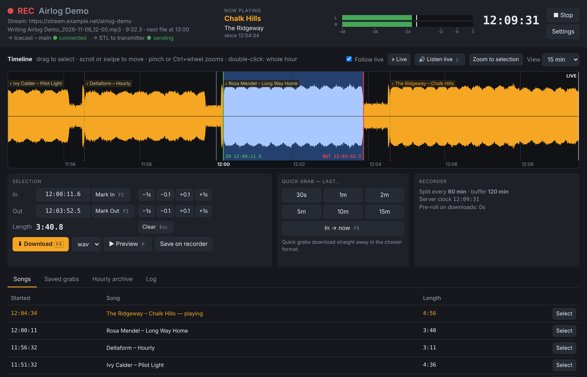
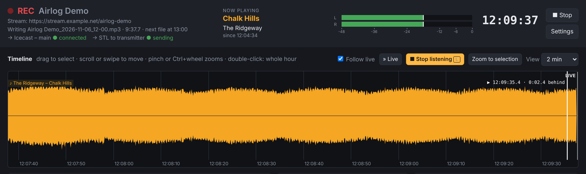
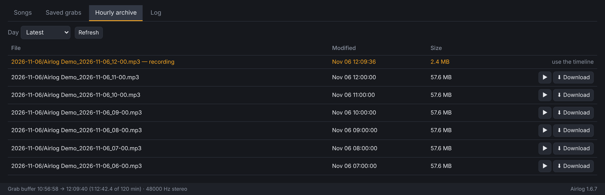
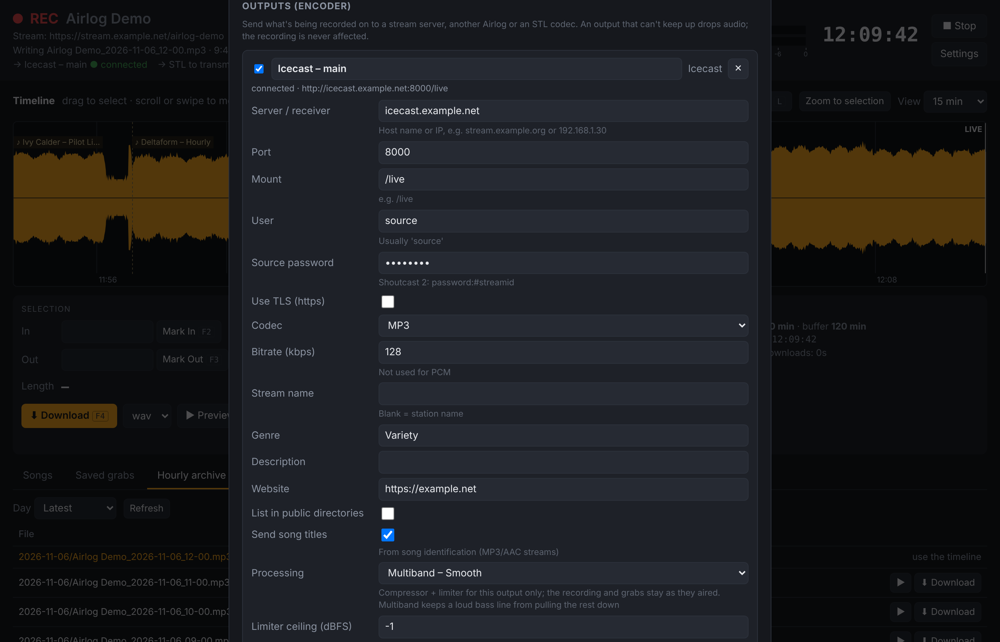

# Airlog

A radio station logger and audio hub. Airlog records the station around the
clock into clock-aligned files, keeps a rolling buffer you can grab clips from
seconds after they air, and can take the station in from almost anywhere and
send it on, processed, to wherever it needs to go.



**Record and grab**
- **Hourly archive:** sample-accurate files split on the clock (60, 30 or 15
  minutes), in MP3, FLAC, WAV or Ogg, and deleted after a set number of days if
  you want.
- **Instant grabs:** select audio on a live waveform and download it seconds
  after it airs, or use the quick-grab buttons for the last 30 s to 15 minutes.
  Clips come out as WAV, MP3 or FLAC, ready for Audition.
- **Song identification:** Shazam names each song and marks it on the timeline,
  so you can select a whole song in one click.

**Sources**
- An internet stream, a sound card, or a stream **sent to** Airlog over SRT,
  UDP, RTP or an Icecast-style push from BUTT, Mixxx, OBS or a playout system.
  That covers logging straight off an STL.
- A **backup source** running alongside the main one takes over automatically if
  the main one drops out or goes silent, with no hole in the recording.

**Outputs**
- Send the station on live to **Icecast or Shoutcast** (with song titles),
  another Airlog or an STL codec over **SRT**, **UDP or RTP**, or out of a
  **sound card** to a transmitter, a desk or monitors.
- Each output can have its own processing: a limiter, a compressor, or a
  **4-band multiband broadcast compressor**. The archive and grabs always stay
  exactly as they aired.

**Everywhere**
- The recorder runs as a background **service** on Windows, Linux or macOS. Anyone
  on the network opens `http://<recorder>:8080/` to use it. Opening the
  **Airlog** app on the recorder itself shows the same UI in its own window.
- **[Airlog Viewer](#airlog-viewer)** for the machines that *use* a recorder: it
  finds recorders on the network, shows whether they're recording, and opens
  them signed in.
- A password (or a trusted-network setting) controls who can change settings.
  There's also an HTTP API for scripting.

| | Download (from the GitHub release / Actions run) | The service |
|---|---|---|
| **Windows** 10/11 x64 | `Airlog-Setup-<ver>.exe` or the portable zip | Windows service, from boot |
| **Linux** x86_64 / arm64 | `airlog_<ver>_<arch>.deb` or `Airlog-<ver>-linux-<arch>.tar.gz` | systemd unit, from boot |
| **macOS** 11+ Apple Silicon | `Airlog-<ver>-macos-arm64.dmg` | launchd agent, while you're logged in |

Every build bundles ffmpeg, so the machine needs nothing else (on Linux, sound
card outputs also use the system's PortAudio, which the `.deb` installs). There's
also a classic all-in-one desktop window (`--classic`) for quick use on one machine.
Airlog Viewer has its own downloads; see [Airlog Viewer](#airlog-viewer).

## Install

### Windows

Run `Airlog-Setup-<ver>.exe` (or unzip the portable build and run `Airlog.exe`,
which offers to install the service).

#### Windows service

The recorder runs as the **Airlog Recorder** service, so it records from boot
whether or not anyone has the UI open or is signed in, and Windows restarts it if
it crashes.

- **`Airlog.exe`** opens the UI in an Edge app window. If the service isn't
  installed it offers to install it; if it's stopped it starts it. Closing the
  window doesn't affect recording. Other PCs on the network can use
  `http://<this-pc>:8080/`.
- **`Airlog.exe --install-service`** (asks for admin) copies the app to
  `C:\Program Files\Airlog`, registers and starts the service, allows the web
  port through the firewall on private/domain networks and adds Start-menu and
  desktop shortcuts. On first install it copies the desktop app's settings.
  Run it again from a new build to upgrade.
- **`Airlog.exe --uninstall-service`** stops and removes the service, the firewall
  rule and the shortcuts. Settings and recordings are kept.
- **`Airlog.exe --classic`** runs the old all-in-one desktop window. Don't record
  with it while the service is running.

The service runs as LocalSystem, so its settings are machine-wide in
`%ProgramData%\Airlog\config.json` (edit them in the UI's Settings), with its log
in `%ProgramData%\Airlog\logs\service.log`. Recordings stay where the settings
point; by default that's `%USERPROFILE%\Airlog` of whoever installed it. Set
**Settings → Password** if the network isn't trusted.

### Linux

Built on Debian 12, so it runs on Debian 12+, Raspberry Pi OS 12+ (64-bit),
Ubuntu 23.04+ and anything of similar age or newer.

**Debian, Ubuntu, Raspberry Pi OS** (the service is set up for the user running `sudo`):

```bash
sudo apt install ./airlog_1.3.0_amd64.deb      # or _arm64.deb
```

**Any distro** (tarball):

```bash
tar -xzf Airlog-1.3.0-linux-x86_64.tar.gz
sudo ./Airlog/Airlog --install-service          # copies to /opt/airlog, adds the airlog command and menu entry
```

Either way you get the `airlog.service` systemd unit. It records from boot,
whether or not anyone is logged in, and restarts if it stops. It runs as your
user (in the `audio` group), so recordings land in `~/Airlog` by default.
Opening **Airlog** from the menu (or running `airlog`) shows the UI; if the
service isn't installed yet it offers to install it.

```bash
journalctl -u airlog -f                 # logs
sudo systemctl restart airlog           # restart
sudo airlog --uninstall-service         # remove the service (settings and recordings are kept)
sudo apt remove airlog                  # .deb: removes the service and the app
```

- Settings: `/var/lib/airlog/config.json` (edit them in the UI's Settings).
- The installer opens the web port in ufw or firewalld if either is active.
- The unit uses `KillMode=mixed`: on stop, systemd signals Airlog first, and Airlog
  closes the archive file and its ffmpeg processes itself. Upgrading with the
  `.deb` adds this to an existing unit; for a tarball install, run
  `sudo airlog --install-service` again to refresh it.
- Machines without a real-time clock (e.g. a Raspberry Pi) rely on NTP; the
  service waits for time sync at boot so file names and grab times are right
  after a power cut.
- Use `--user NAME` with `--install-service` to run the recorder as another account.

### macOS

Open the `.dmg`, drag **Airlog** to Applications and open it. It offers to
install the recorder as a login agent, which starts when you log in and is
restarted if it stops. No admin password is needed.

- The app isn't signed by Apple, so the first time macOS blocks it: open
  **System Settings → Privacy & Security** and click **Open Anyway**, or run
  `xattr -dr com.apple.quarantine /Applications/Airlog.app`.
- The agent runs in your login session because that's where macOS allows
  microphone access. The first sound-card capture asks for permission; if you
  missed it, enable Airlog under **Privacy & Security → Microphone**.
- For unattended recording from boot, turn on automatic login (**Users &
  Groups**) and stop the Mac sleeping (**Energy** / **Battery** settings, or
  `sudo pmset -a sleep 0`).
- Settings: `~/Library/Application Support/Airlog/service.json`. Log:
  `~/Library/Logs/Airlog/service.log`.
- Remove it with `/Applications/Airlog.app/Contents/MacOS/Airlog --uninstall-service`
  (settings and recordings are kept), then drag the app to the Bin.

### Sound card input

In **Settings** choose **Sound card input**, press **Refresh** and pick the device.

- **Linux:** driver **alsa** (the service can't reach a desktop PulseAudio/PipeWire
  session). Pick a `plughw:X,Y` entry: `plughw` lets ALSA convert to 48 kHz
  stereo if the interface runs at another rate. Set the record level with
  `alsamixer`. The FFmpeg bundled on Linux can't read ALSA itself, so Airlog
  reads the card through PortAudio (`libportaudio2`, which the `.deb` installs;
  for the tarball, `sudo apt install libportaudio2`) and passes the audio on.
- **macOS:** driver **avfoundation**.
- **Windows:** driver **dshow**.

### Storage

The grab buffer is raw PCM, about **690 MB per hour** at 48 kHz stereo, written
continuously. On a machine booting from an SD card (e.g. a Raspberry Pi), point
**Settings → Buffer folder** and the archive/grabs folders at a USB SSD so the
card doesn't wear out.

## Airlog Viewer

A small app for the PCs and Macs that grab audio from a recorder. It records
nothing itself.

- Lists the recorders on your network automatically (they announce themselves
  with mDNS / Bonjour), plus any you add by address (`192.168.1.20`,
  `studio-pc`, `studio-pc:9000`; port 8080 if you leave it out). You can save
  several and switch between them.
- Shows whether each one is up and recording.
- **Open** (or double-click) opens the recorder's UI in a Chrome or Edge app
  window, or your default browser if neither is installed (untick *Open in an
  app window* to always use the default browser). Downloads land in that
  browser's Downloads folder.
- If a recorder has a web password, the viewer asks once, can keep it in the
  keychain (Windows Credential Manager, macOS Keychain, or GNOME Keyring /
  KWallet on Linux), and opens the UI already signed in. It never puts the
  password in a URL: it gets a single-use, 60-second sign-in link instead,
  and the browser stays signed in for 30 days.
- A saved recorder found by its network name follows it if its IP address changes.
- `AirlogViewer --open "Studio A"` (or an address) opens one straight away,
  for a desktop shortcut.

| | Download |
|---|---|
| **Windows** | `Airlog-Viewer-Setup-<ver>.exe` (installs for the current user, no admin) or `Airlog-Viewer-<ver>-win64.zip` |
| **Linux** | `sudo apt install ./airlog-viewer_<ver>_<arch>.deb`, or unpack `Airlog-Viewer-<ver>-linux-<arch>.tar.gz` and run `AirlogViewer/AirlogViewer` |
| **macOS** | `Airlog-Viewer-<ver>-macos-arm64.dmg`: drag to Applications. Unsigned, so the first time use **Open Anyway** in Privacy & Security. On macOS 14+ allow *Local Network* access when asked, or it can't find recorders |

Automatic discovery needs multicast to pass between the viewer and the
recorder, so it works on one LAN or VLAN but usually not across routers or a
VPN. Add those recorders by address. **Settings → Announce on the network**
turns the announcement off.

## Using the browser UI



- **Waveform:** shows from 1 minute up to the length of the grab buffer (at most
  2 hours), following live. You can't scroll back past the oldest audio still in
  the buffer, since that's as far back as you can grab.
  - Drag to select, drag an edge to adjust, Shift-click to extend.
  - Double-click selects the whole hour.
  - Wheel or a sideways trackpad swipe scrolls; Ctrl+wheel (or trackpad pinch) zooms.
  - **Zoom to selection** helps with fine edits.
- **Mark In (F2)** when an item starts and **Mark Out (F3)** when it ends.
  - **Download (F4)** fetches the selection.
  - **In → now (F5)** takes everything from the in-point up to live.
- **Nudge** buttons move In or Out by ±0.1 s or ±1 s. You can also type exact
  times (`HH:MM:SS.s`, or `MM:SS` in the current hour).
- **Preview (P)** plays the selection in the browser, with a playhead on the
  waveform. With only an In marked, it plays on past where live was, keeping up
  with the recording; marking Out while it plays stops it there.
- **Listen live (L)** plays what's being recorded, a second or two behind; the
  playhead shows how far behind you are.
- **Quick grab** buttons download the last 30 s, 1, 2, 5, 10 or 15 min
  immediately.
- **Download** goes straight to your machine as WAV, MP3 or FLAC, ready to open
  in Audition. **Save on recorder** stores the clip in the recorder's grabs folder
  instead, listed under *Saved grabs*.
- **Hourly archive** lists the finished hourly files to play or download.

  
- **Output switches:** each output listed under the station name has an on/off
  switch. It takes effect straight away and is saved, and the recording isn't
  interrupted: use it to take a stream down without stopping the logger. It
  needs the same permission as Start/Stop.
- **Settings** edits everything (source, formats, folders, buffer, password).
  Saving restarts the recorder, and the gap of a second or two is filled with
  silence.

Several people can use the UI at once; each browser has its own selection.

**Access:** with no web password, anyone who can reach the UI can listen, grab
and download, but **changing settings and starting/stopping the recorder only
work from a browser on the recorder itself** (`http://localhost:8080/`, which is
what the Airlog app opens). Two ways to allow it from other machines:

- **Settings → Trusted network**: no password; any machine that can reach the
  UI may change settings and start/stop recording. Fine on a LAN behind a
  firewall with nothing forwarded to it.
- **Settings → Web password**: everything needs a login (HTTP Basic in a
  browser; Airlog Viewer signs in for you), and signed-in users can change
  settings from anywhere.

Whoever can change settings can point Airlog at any folder and run any ffmpeg
input, so give that ability only to people and networks you trust. The ffmpeg
path itself can only be changed in the config file, and the UI only serves and
deletes audio files. For access from outside the building, use a VPN (e.g.
WireGuard) or nginx with HTTPS. Don't port-forward it.

## What the recorder does

- **Source:** an internet stream (Icecast/Shoutcast/HLS/.pls/.m3u), a sound card
  input, a stream **sent to** the recorder (SRT, UDP, RTP, or an Icecast-style
  push; see [Streaming](#streaming-in-and-out)), or any custom ffmpeg input.
- **Backup source:** a second source runs alongside the main one and takes over
  automatically if the main source drops out or goes silent, then hands back
  when it recovers. See [Backup source](#backup-source).
- **Encoder outputs:** sends what it records on to Icecast/Shoutcast, another
  Airlog, or an STL codec, at the same time as recording it, with optional
  compressor and limiter processing per output.
- **Hourly archive:** MP3/FLAC/WAV/OGG files split exactly on the clock (60, 30
  or 15 minutes). The split is sample-accurate, because Airlog cuts the PCM
  itself.
- **Source delay:** streams arrive several seconds behind air. Set
  **Source delay** and timestamps and file splits shift back, so the pips land
  at the top of the file.
- **Resilient:** it reconnects automatically after a stream drops and fills the
  gap with silence, keeping times aligned. A watchdog restarts a stalled source,
  and there's a silence alert.
- **Restarts:** the grab buffer survives a service restart and a reboot.
- **Song identification:** every 30 s (configurable) Airlog sends a 12-second
  sample of the audio to Shazam. The current song, with its cover art, appears at
  the top of the page. Each song is labelled on the timeline (click a label to
  select the song), and the **Songs** tab lists what played. It works for any
  source, including a sound card. See below.

### Streaming in and out

Airlog can be the far end of a link (**Receive a stream**) and an encoder
(**Outputs**), so it can log an STL feed, feed your listener stream, or link a
studio Airlog to one at the transmitter site.



**Receive a stream** (Settings → Source → *Receive a stream*). Senders connect
to the recorder:

| Receive | Port | Senders |
|---|---|---|
| **SRT** | UDP | another Airlog's SRT output, OBS, ffmpeg, SRT-capable STL codecs. Optional passphrase (10–79 characters) and latency (200 ms on a LAN, 1000–2000 ms over the internet) |
| **Icecast push** | TCP | anything with an Icecast "source" output: BUTT, Mixxx, OBS, playout systems' stream-out, another Airlog's Icecast output. Senders use the **source password**, any user name and any mount. One sender at a time. Like Liquidsoap's *harbor*, without Liquidsoap |
| **UDP (MPEG-TS)** | UDP | codecs that send MPEG-TS over UDP, unicast or multicast (set the group) |
| **RTP** | UDP | RTP codecs (Barix and similar). MPEG audio (mp2/mp3) works as is; for PCM/L16, Opus or AAC, paste the sender's SDP |

The status line shows *Waiting for a sender* until audio arrives. When the
sender stops, the gap is filled with silence and Airlog waits for it to come
back, like a dropped stream. The receive port has to be open in the recorder's
firewall:

```bash
sudo ufw allow 9000/udp        # Linux, SRT/UDP/RTP on port 9000
sudo ufw allow 8000/tcp        # Linux, Icecast push on port 8000
sudo firewall-cmd --permanent --add-port=9000/udp && sudo firewall-cmd --reload    # firewalld
```

On Windows the installer allows Airlog.exe and its bundled ffmpeg.exe (which
does the SRT, UDP and RTP listening) to accept connections on any port, TCP and
UDP, on private and domain networks. The network has to be set to *Private* in
Windows: rules for public networks aren't created. Upgrading from 1.6.2 or
earlier: run the new installer (or `Airlog.exe --install-service`) to get the
ffmpeg.exe rule; until then SRT/UDP/RTP senders get no answer. On macOS, allow incoming connections for Airlog if
asked.

**Outputs** (Settings → Outputs). Add as many as you like; each has its own
on/off switch and status, shown under the station name (hover for details):

| Output | Codecs | Notes |
|---|---|---|
| **Icecast** | MP3, AAC, Ogg Vorbis, Opus | Server, port, mount, source user and password; optional TLS. Sends song titles from song identification (MP3/AAC). Works with Icecast 2.4+ and older servers |
| **Shoutcast** | MP3, AAC | Shoutcast v1 source protocol (DNAS 1.x, or 2.x with `password:#streamid`). Song titles too |
| **SRT** | AAC, MP2, MP3, Opus, PCM | **Caller** connects to a receiver (e.g. another Airlog set to *Receive → SRT*); **Listener** waits for the receiver to connect. PCM is uncompressed (SMPTE 302M in MPEG-TS) |
| **UDP** | AAC, MP2, MP3, Opus, PCM | MPEG-TS, unicast or multicast |
| **RTP** | PCM (L16), MP2, MP3, Opus, AAC | The output's card in Settings shows the SDP to give the receiver |
| **Sound card** | — | Plays what's being recorded out of a sound card on the recorder: feed a transmitter, a desk or monitors. See below |

An output that can't keep up (slow network, server gone) drops its oldest
audio and reconnects with a back-off. The recording itself is never held up.

If the source stalls or drops, the outputs send **silence** after a second
without audio, as a broadcast encoder does. Icecast and Shoutcast servers keep
the connection (Shoutcast DNAS 2 drops a source that sends nothing for just a
few seconds), and listeners hear a gap, not a disconnect. When the source returns, the
programme carries on in the same stream.

**Sound card output.** Pick the card with **Refresh**; the choice is saved by
name, so it survives reboots and other cards being plugged in. **Buffer (ms)**
(default 200) is the delay to the card: Airlog keeps that much audio queued so
timing jitter never causes a gap; raise it if the audio crackles. If the source
stalls the card gets silence (no glitch), and when the source returns the delay
is back to the buffer setting rather than growing. Unplugging the card shows an
error and playback resumes when it's back. Processing (compressor, multiband,
limiter) works on it like any other output.

- **Windows / macOS:** nothing extra to install. On Windows, the WASAPI entries
  convert the sample rate for you; if a card refuses 48 kHz, try its MME or
  DirectSound entry.
- **Linux:** needs PortAudio. The `.deb` installs it; with the tarball run
  `sudo apt install libportaudio2`. The service reaches the cards through ALSA,
  not a desktop's PulseAudio/PipeWire, so pick the card's own entry (or
  `default`).
- Sound card output from the Windows *service* hasn't been tested on real
  hardware yet: if the card shows an error there but works from
  `Airlog.exe --classic`, Windows is keeping the service away from audio
  devices on that machine.

**Processing** (per output, under *Processing* on its card). A compressor and
peak limiter for that output only; the archive, grabs and other outputs stay
exactly as they aired:

| Processing | What it does | Quiet / loud gap (measured, from 24 dB) |
|---|---|---|
| Off | Nothing | 24 dB |
| Limiter only | Holds peaks at the ceiling; levels otherwise untouched | 24 dB |
| Gentle | 2:1 from -18 dBFS: evens out levels, barely audible | 18 dB |
| Broadcast | 4:1 from -22 dBFS: a consistent, denser "radio" level | 13 dB |
| Heavy | 8:1 from -28 dBFS: loud and dense, for noisy listening | 6 dB |
| Custom | Your threshold, ratio, attack, release and make-up gain | — |
| Multiband – Smooth | 4-band, gentle ratios: a polished but open sound | 16 dB |
| Multiband – Punchy | 4-band, 4:1, slower bass attack so kick drums keep their punch | 13 dB |
| Multiband – Loud | 4-band, 8:1: dense and loud | 8 dB |

The presets keep loud passages at about the level they came in and bring quiet
ones up. Every setting ends with a peak limiter at the **ceiling** (-1 dBFS by
default). It limits sample peaks; leave a little headroom for lossy codecs, so
-1 to -2 dBFS for MP3/AAC streams.

**Multiband** splits the audio into four bands (bass below 120 Hz, low-mid to
800 Hz, presence to 4 kHz, air above) and compresses each on its own, after a
30 Hz high-pass and a slow AGC that rides the overall level over several
seconds. The bands add back up flat (measured: 0.0 dB at every frequency), so it
doesn't colour the sound by itself. Because each band only reacts to itself, a
loud bass line no longer pulls the vocals and treble down ("pumping"). In the
tests, a steady treble tone dips 12 dB with the wideband *Broadcast* preset when
a loud bass note comes in, and under 1 dB with any multiband preset. Each
multiband output also has:

- **Bass / Low-mid / Presence / Air trim**: ±12 dB per band, after compression
  (e.g. a little presence for speech on small speakers).
- **Drive**: more level into the compressors for a denser, louder sound (the
  ceiling still holds the peaks).

It's built from ffmpeg's crossover, compressor and limiter filters, so it runs on
every platform with nothing extra installed. It isn't a full broadcast processor:
there's no clipper, stereo enhancer or FM pre-emphasis handling.

**STL note:** SRT resends lost packets and copes well with a decent internet
connection, so Airlog to Airlog makes a good backup STL. As the only path to a
transmitter, a dedicated codec (dual networks, watchdogs, appliance hardware)
is still the safer choice.

### Backup source

Settings → **Backup source**. The backup is any kind of source (an internet
stream, a sound card, a received stream, or custom ffmpeg input) and runs
alongside the main one all the time, so a switch is instant. A typical setup is
the STL as the main source and the station's web stream as the backup.

- **Switch after no audio for (s)** (default 5): the main source stops
  delivering audio (dropped stream, sender gone, sound card unplugged).
- **…or silence for (s)** (default 60; 0 = off): the main source is below the
  silence level that long while the backup isn't (dead air on the STL).
- **Switch back after (s)** (default 30): the main source has to be healthy that
  long, continuously, before Airlog switches back, so a source that keeps
  dropping can't bounce the recording back and forth.
- **Backup delay (s)**: like *Source delay*, for the backup. A web stream is
  usually 10–30 s behind an STL. Set this so the backup's timestamps match air
  and a switch doesn't repeat or skip audio.

When the main source drops out, the few seconds before the switch are filled
from the backup's recent audio, so the archive has no hole. The header shows
**REC · ON BACKUP** in amber, with why and when it switched, and every switch is
in the log. At start-up the main source gets 15 s to connect before the backup
takes over.

### Song identification

This uses [shazamio](https://github.com/shazamio/ShazamIO), an *unofficial*
client for Shazam's private app API. It needs no account or key. Shazam doesn't
support it, so it can stop working without notice, and heavy use may be
rate-limited. An occasional slow or missed answer is skipped quietly; after three
misses in a row the page says Shazam can't be reached, the log says why (no
answer, or rate-limited), and Airlog checks less often until it's back. Recording is never affected.

- Shazam reports how far into the song the sample was, so each song's start time
  is estimated from that. Treat the times as a guide, accurate to a second or
  two, and check the edges before you download a song.
- Speech, jingles and ads don't match. After two checks in a row with no match,
  the current song is closed.
- Only the 12-second samples are sent, and only while recording. Turn it off
  under **Settings → Song identification**.
- The song list matches the grab buffer: songs drop off it once they've left the
  buffer, since they can no longer be selected or grabbed. It's kept in
  `tracks.json` in the grab buffer folder, so it survives restarts.
- The Windows, Linux and macOS builds include it. From source, run
  `pip install shazamio`.

## Desktop app (single machine)

```bash
# Windows
winget install Python.Python.3.12 ; winget install Gyan.FFmpeg ; py -m airlog
# macOS
brew install python-tk ffmpeg && python3 -m airlog
# Linux
sudo apt install python3-tk ffmpeg && python3 -m airlog
```

It has the same features, plus *Open in editor after grab* (set the editor path
in Settings → Grabs). On Windows, double-clicking `run_airlog.pyw` launches it
without a console. The packaged builds open it with `--classic`; don't record
with it while the service is running.

## Building

### Windows

On any Windows 10/11 PC with Python 3.10+ (`winget install Python.Python.3.12`),
double-click **`build_windows.bat`** (or run `.\build_windows.ps1`). It:

1. creates a private build environment and installs PyInstaller;
2. downloads an **LGPL** ffmpeg (BtbN's `win64-lgpl` build) and bundles
   `ffmpeg.exe`, `ffprobe.exe` and `ffplay.exe`, so the PC needs nothing else.
   `packaging/check_ffmpeg.py` checks it's LGPL and has every codec, protocol and
   filter Airlog uses, and writes `licenses/ffmpeg-NOTICE.txt` with the exact
   version and where its source is;
3. builds `dist\Airlog\Airlog.exe` with the Airlog icon and version info;
4. **self-tests the exe** (`Airlog.exe --selftest`): Tk, the bundled ffmpeg,
   and a real 4-second capture, archive file and grab;
5. writes `dist\Airlog-<version>-win64.zip` (portable, unzip and run);
6. builds and self-tests Airlog Viewer and writes
   `dist\Airlog-Viewer-<version>-win64.zip`;
7. if Inno Setup is installed (`winget install JRSoftware.InnoSetup`), also
   writes `dist\Airlog-Setup-<version>.exe`, an admin installer that puts Airlog
   in Program Files and installs the service, and
   `dist\Airlog-Viewer-Setup-<version>.exe`, a per-user viewer installer.

The exe isn't code-signed, so Windows SmartScreen will warn on first run
(*More info → Run anyway*).

### Linux and macOS

On the machine type you're building for (the build is for its own CPU), run
**`./build_unix.sh`**. It needs Python 3.10+ with tkinter, `curl` and `unzip`
(Linux also `xz-utils`, `binutils`, `xvfb` for a headless self-test, and
`dpkg-dev` for the .deb). It:

1. creates a private build environment and installs PyInstaller;
2. gets a static **LGPL** ffmpeg and bundles it. On Linux that's BtbN's
   `-lgpl` build. On macOS every prebuilt download is a GPL build, so
   `packaging/build_ffmpeg_macos.sh` builds one from source with only what
   Airlog uses (about 10 minutes the first time; CI caches it). Or use your own:
   `FFMPEG_DIR=/path/to/static/ffmpeg ./build_unix.sh`. Either way
   `packaging/check_ffmpeg.py` checks it as on Windows;
3. builds `dist/Airlog/Airlog` (Linux) or `dist/Airlog.app` (macOS);
4. **self-tests the build** the same way as the Windows exe;
5. writes `dist/Airlog-<version>-linux-<arch>.tar.gz` and
   `dist/airlog_<version>_<arch>.deb` (skip it with `--no-deb`), or
   `dist/Airlog-<version>-macos-<arch>.dmg`;
6. builds, self-tests and packages Airlog Viewer the same way
   (`Airlog-Viewer-…`, `airlog-viewer_…deb`).

A Linux build runs on distros with the same or a newer glibc than the build
machine, which is why CI builds on Debian 12.

### GitHub Actions

`.github/workflows/build.yml` builds Windows x64, Linux x86_64 and arm64, and
macOS Apple Silicon on every push and pull request. Download the packages from
the run's *Artifacts*. Pushing a tag like `v1.3.0` attaches them all to a
release.

## Running from source

The recorder and web UI run anywhere Python 3.10+ and ffmpeg do:

```bash
pip install flask waitress            # plus shazamio for song identification
python3 -m airlog.server --config ./config.json --port 8080
```

Note that `--config` creates the file if it doesn't exist. On Linux and macOS,
`python3 -m airlog --install-service` installs the service from a source
checkout too (it runs `python3 -m airlog --service` from that folder, so leave
the checkout where it is).

## Where things go

| | Default |
|---|---|
| Hourly files | `~/Airlog/Archive/YYYY-MM-DD/Station_YYYY-MM-DD_HH-00.mp3` |
| Grabs saved on recorder | `~/Airlog/Grabs/` |
| Grab buffer | `~/Airlog/.spool` |
| Settings (service) | Windows: `%ProgramData%\Airlog\config.json` · Linux: `/var/lib/airlog/config.json` · macOS: `~/Library/Application Support/Airlog/service.json` |
| Airlog Viewer's list | Windows: `%APPDATA%\Airlog\viewer.json` · Linux: `~/.config/airlog/viewer.json` · macOS: `~/Library/Application Support/Airlog/viewer.json` (passwords are in the keychain) |
| Settings (classic window) | Windows: `%APPDATA%\Airlog\` · Linux: `~/.config/airlog/` · macOS: `~/Library/Application Support/Airlog/config.json` |

File names use strftime codes plus `{station}`; a `/` creates sub-folders. The
time in an archive name is that file's start, so the first file after a start is
a partial (e.g. `12-17`) and every file after that starts on the boundary.

## HTTP API

The browser UI uses these; they're handy for scripting too.

| | |
|---|---|
| `GET /api/status` | state, live time, levels, current file, outputs, receive input, failover |
| `GET /api/peaks?from=&to=&n=` | waveform buckets (0–255) |
| `GET /api/clip?from=&to=&fmt=wav\|mp3\|flac[&download=1]` | stream a clip (epoch seconds) |
| `POST /api/grab {from,to,fmt}` | save a clip on the recorder |
| `GET /api/grabs`, `DELETE /api/grabs/<path>` | saved grabs |
| `GET /api/archive[?date=YYYY-MM-DD]` | hourly files |
| `GET /api/tracks[?limit=200]` | identified songs, newest first (`now_playing` is also in `/api/status`) |
| `GET/POST /api/config` | settings (POST: signed in, local browser, or *Trusted network*) |
| `POST /api/record {action: start\|stop}` | control (as above) |
| `POST /api/login {password}` | single-use sign-in token for `GET /login?t=` (used by Airlog Viewer) |

For example, to get the last two minutes as an MP3 from a shell:

```bash
now=$(date +%s); curl -o clip.mp3 "http://recorder:8080/api/clip?from=$((now-120))&to=$now&fmt=mp3"
```

## Test

- `python tests/test_engine.py` fakes the clock (inside the test only) to 8 s
  before the hour, records a tone with a simulated dropout, and checks the
  split, the gap fill and a grab.
- `python tests/test_boundary.py` checks archive splits across the clocks going
  back and forward (Linux/macOS).
- `python tests/test_access.py` checks who may change settings or control
  recording (including *Trusted network*), and that only audio files are served.
- `python tests/test_login.py` checks Airlog Viewer's one-time sign-in links
  and the session cookie.
- `python tests/test_streaming.py` runs real links with ffmpeg: one Airlog
  sending a tone over SRT (with and without a passphrase, AAC and PCM), UDP,
  RTP (with and without SDP) and Icecast push (MP3 and Opus) to another that
  receives it; plus wrong passwords, the Icecast SOURCE fallback, song titles,
  Shoutcast v1, and a stalled server not holding up recording.
- `python tests/test_failover.py` runs a main source it can cut, silence and
  restore, with a backup tone at a different level: failover on dropout (no
  hole in the recording), on silence, no flapping, switching back, and starting
  on the backup when the main never connects.
- `python tests/test_device.py` runs sound card outputs against a stand-in card
  that plays in real time: steady delay, silence on a stall, backlog dropped,
  processing, unplug/replug, device lookup and messages.
- `python tests/test_processing.py` measures every processing preset on a test
  signal (level gap, peaks vs ceiling), checks multiband against pumping, tonal
  balance, band trims and drive, and checks a limited output end to end.
- `python tests/test_nowplaying.py` checks the song-change logic against canned
  Shazam answers (no network).

CI runs them all on Linux after each build.
